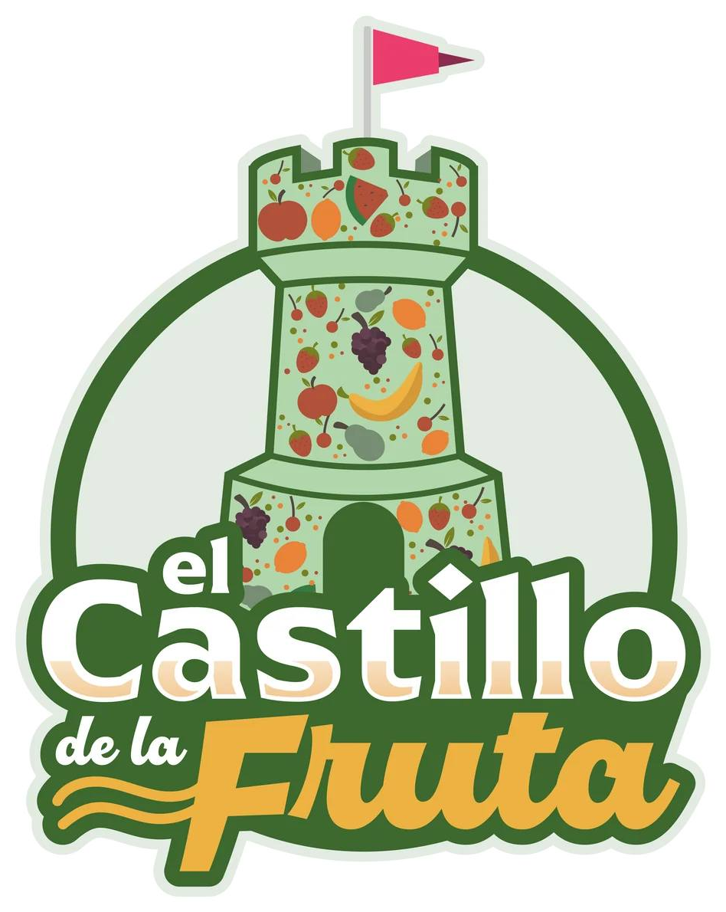

Hola, soy André Gutiérrez Baeza 👋
Ingeniería en Informática @ AIEP | Talento Digital SENCE - TI y Ciberseguridad
Python
SQL
Linux
Git
Networking
Firebase

---
🏰 Proyecto destacado — El Castillo de la Fruta
Sistema de gestión de pedidos para verdulería — versión v1.0.13 en uso real en tienda
> De pegar un pedido por WhatsApp a una hoja lista para imprimir y cortar por cliente.
📋 Pegas el pedido, Analizar y Agregar a la hoja
🖨️ Descargar DOCX real con logo chico en cada pedido, compacto, 3 por página, listo para cortar
📱 Funciona en Android con Abrir siempre con el programa de impresión
🟢 En vivo, usado todos los días en la tienda
Stack del proyecto: HTML · CSS · JavaScript · Firebase Hosting · DOCX real (ZIP + XML en JS puro)
---
🧠 Actualmente
🔭 Trabajando en: Sistema de gestión de pedidos para verdulería v1.0.13
🌱 Aprendiendo: Python, SQL, Fundamentos de Ciberseguridad (Google)
💡 Dato: 2 años en atención al cliente y seguridad en retail — sé traducir problemas técnicos a personas
🛠️ Stack
`Python` `SQL` `Linux` `Git` `Networking` `JavaScript` `HTML` `CSS` `Firebase`
📫 Contacto
[LinkedIn](https://www.linkedin.com/in/andr%C3%A9-alejandro-alexis-gutierrez-baeza-482b0b267/)
---

El Castillo de la Fruta — De la idea a la app que usamos hoy en la tienda.

